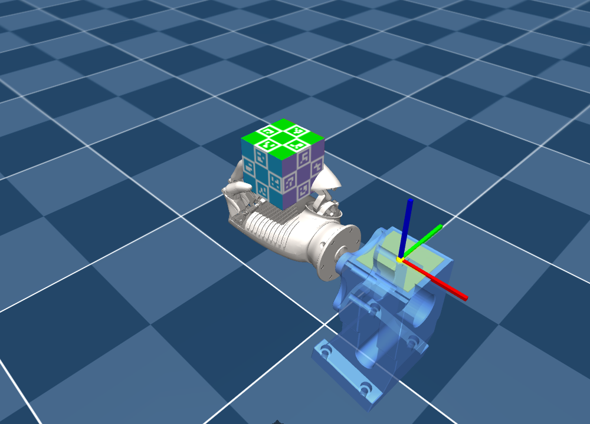

# ROHand A001 转方块

基于 [Wuji MJLab](https://github.com/wuji-technology/wuji-mjlab) 的 ROHand **A001 右手**方块姿态控制。沿用原项目任务、PPO 和主要奖励，通过最小适配接入 A001；当前包含每秒最高 -10 分的停滞惩罚和异常训练数据隔离。训练算法为 PPO。



## 安装

需要 Linux、NVIDIA GPU、兼容 CUDA 12.8 的驱动，以及 [Pixi](https://pixi.sh)。服务器验证使用 H100。依赖锁定为 Python 3.11、mjlab 1.6.0、rsl-rl 5.4.2、Torch 2.7.1+cu128、MuJoCo/MuJoCo Warp 3.11.0、Warp 1.17.0。

```bash
git clone --recurse-submodules https://github.com/Violit-hub/rohand-.git
cd rohand-
pixi install --frozen
```

如果普通克隆时没有拉取子模块，补充执行 `git submodule update --init --recursive`。A001 模型、方块资源、夹具网格及连杆初始化数据已包含；保留的上游任务注册仍需要 Wuji description 子模块。

## 回放附带权重

```bash
pixi run python scripts/rohand/play.py
```

打开终端显示的 `http://127.0.0.1:8779`，点击 **Play**。**Reset Environment** 会更换随机目标与手掌倾角。绿色线框显示目标朝向，位于实际方块旁边，仅作参考。回放使用确定性策略均值，动作保持截断在 [-1,1]。

在服务器上运行时，可在本机另开终端建立端口转发，再访问本机 8779：

```bash
ssh -N -L 8779:127.0.0.1:8779 USER@SERVER
```

自选权重或无界面检查：

```bash
pixi run python scripts/rohand/play.py --checkpoint path/to/model.pt
pixi run python scripts/rohand/play.py --steps 200
```

附带的是 **第 11,100 轮训练中快照**，约 9 MB，包含网络、归一化和优化器状态；不是已收敛或最佳效果的声明。它保留了历史训练中很大的 Critic 归一化方差。详见 [权重说明](pretrained/README.md) 和 SHA-256 [元数据](pretrained/model_11100.json)。

## 从头训练

```bash
pixi run python scripts/rohand/train.py --num-envs 12228 --iterations 5000
```

12,228 个环境用于 H100；显存较小可先用 `--num-envs 1024`。该命令调用原项目训练入口，每 50 轮保存权重，日志位于 `logs/rsl_rl/wuji_reorient_hand2/`。需要长时间运行可增大 `--iterations`，按 Ctrl+C 停止后保留已经保存的检查点。

原入口及配置也保留：

```bash
pixi run train --config configs/rohand_a001.yaml
```

## 继续训练

```bash
pixi run python scripts/rohand/train.py \
  --checkpoint pretrained/model_11100.pt \
  --num-envs 12228 --iterations 1000000
```

`--iterations` 是本次追加的更新数。恢复网络、优化器、归一化及环境计步；便携入口还恢复运行时课程状态，并保持原有随机扰动进度尺度，避免延长训练时把扰动进度一起拉长。新权重把课程状态写入 checkpoint；附带权重通过同名 JSON 补齐该状态。继续训练会继承该权重的归一化统计；从头训练则建立新统计。

## 实现与验证

- [适配说明、控制限位、初始姿态与已知问题](docs/ROHAND_A001.md)
- [原项目来源与固定版本](README_UPSTREAM.md)
- 训练/回放入口：`scripts/rohand/`
- A001 资产：`src/wuji_mjlab/assets/robots/rohand_a001/`
- 任务沿用名称：`WujiHand2_Reorient_50Hz`，在本仓库中对应 A001。

```bash
pixi run python -m pytest tests/test_a001_stagnation.py tests/test_a001_isolation.py -q
```

物理异常隔离防止异常样本进入 PPO，尚未修复底层连杆的不稳定；此前异常集中在小指被动连杆。上游 Wuji 真机部署代码保留，但没有适配 A001 真机；本项目验证范围为仿真训练与回放。

## 来源与许可

Wuji 任务代码保留原版权、[Apache-2.0 LICENSE](LICENSE) 和 [NOTICE](NOTICE)。基线提交为 `b2b98d7054a8d1b0f5cf295d5acaebc4358bc6a9`。ROHand 厂商模型保留原始 XML、厂商 README 和来源校验信息；上游软件许可证不构成对第三方模型资产的重新授权。更多信息见 [A001 资源说明](src/wuji_mjlab/assets/robots/rohand_a001/README.md)。
